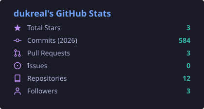

<!-- ===================================================== -->
<!--                      HEADER                           -->
<!-- ===================================================== -->

# Hey, I'm Prince Joseph Magdadaro

 

Cebu, Philippines · Turning ideas into software, and software into good live shows.

 

<!-- ===================================================== -->
<!--                      ABOUT ME                         -->
<!-- ===================================================== -->

## About Me

I'm an **Information Systems student at the University of San Carlos**, interested in how technology, people, and processes fit together, and in building software that actually solves real problems.

I split my time between two worlds that turn out to overlap more than you'd think:

- **Development:** web apps, UI/UX, and information systems.
- **Esports production:** live broadcasts, overlays, and tournament operations.

Both are about the same thing: making complicated stuff run smoothly while people are watching.

<!-- ===================================================== -->
<!--                  CURRENTLY / NOW                      -->
<!-- ===================================================== -->

## Right Now

- **Building:** My school finals project this semester
- **Learning:** Next.js, React Native, application architecture
- **Producing:** Improving the UI/UX of my broadcast control panel
- **Ask me about:** Web dev, live production, breaking into IS

<!-- ===================================================== -->
<!--                  BEHIND THE BROADCAST                 -->
<!-- ===================================================== -->

## Behind the Broadcast

Most developers never have to ship something that goes live in front of an audience with no undo button. I do, and it has made me a more careful, more calm-under-pressure builder.

**What I do on production days:**

- Run live shows with **vMix** and **OBS Studio**: scenes, transitions, graphics, and replays.
- Set up **overlays and scoreboards** so matches look clean and stay readable.
- Help coordinate **tournament flow**: schedules, brackets, and keeping the crew in sync.

**What it taught me about software:**

- Plan for failure, because something *will* break mid-show.
- Fast, simple tools beat clever, fragile ones.
- Good UX is invisible. If viewers notice the overlay, it's wrong.

<!-- TODO: add a screenshot or GIF of an overlay or broadcast you made, e.g.

-->

<!-- ===================================================== -->
<!--                  FEATURED PROJECTS                    -->
<!-- ===================================================== -->

## Featured Projects

| Project | What it does | Stack |
|---|---|---|
| **[Motra Website](https://github.com/dukreal/Motra-Website)** | Money tracker web app for logging and managing personal finances. In progress. | `React` `Vite` |
| **[Motra Mobile](https://github.com/dukreal/MobileMoneyTracker-MobDev)** | The mobile version of Motra, built as a cross-platform app. | `React Native` `TypeScript` `Supabase` |
| **[La Consolacion](https://github.com/dukreal/La-Consolacion)** | Jewelry shop web application with a database-backed catalog. | `PHP` `SQL` |
| **MLBB Tournament Overlay** *(private)* | Broadcast overlay and control panel for Mobile Legends tournaments, built for live production use. | `JavaScript` `HTML` `CSS` |
| **[Portfolio](#)** *(in progress)* | My personal site, a home for everything above. | `Next.js` `Tailwind` |

> Check my pinned repositories for more. In-progress work counts too, and I'm always building something.

<!-- ===================================================== -->
<!--                      TECH STACK                       -->
<!-- ===================================================== -->

## Tech Stack

### Daily drivers

  
  
  
  
  
  
  
  
  
  
  
  

### Exploring

  
  
  
  
  

### Tools & Production

  
  
  
  
  
  
  
  

<!-- ===================================================== -->
<!--                   AREAS OF INTEREST                   -->
<!-- ===================================================== -->

## What I'm Into

- **Web Development:** responsive, functional apps people enjoy using.
- **Information Systems:** how technology, people, and processes work together.
- **UI/UX Design:** clean, accessible, no-nonsense interfaces.
- **Software Architecture:** how good apps are structured under the hood.
- **Automation:** connecting tools so nobody repeats boring tasks.
- **Live Production:** broadcasts, overlays, and tournament operations.

<!-- ===================================================== -->
<!--                   GITHUB STATISTICS                   -->
<!-- ===================================================== -->

## GitHub Stats

 

 

<!--
OPTIONAL: contribution snake
Set up the Platane/snk GitHub Action in a "dukreal/dukreal" profile repo,
then add the generated image here.
-->

<!-- ===================================================== -->
<!--                   CONNECT WITH ME                     -->
<!-- ===================================================== -->

## Let's Connect

Want to collaborate, talk projects, or ask how I got into broadcasting? My inbox and DMs are open.

<!-- ===================================================== -->
<!--                       FOOTER                          -->
<!-- ===================================================== -->

### Thanks for stopping by!

**Fun fact:** [Add something personal here: your favorite game, a go-to energy drink, a broadcast horror story.]

Built with curiosity, caffeine, and a lot of scene transitions.

